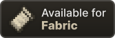
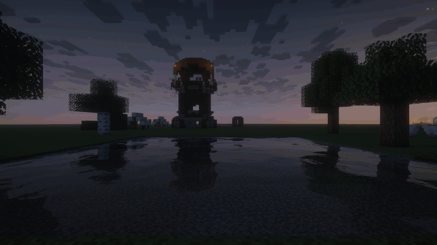

  

<h1 align="center">Sleep Trails</h1>

  <strong>Watch the night turn into morning.</strong> 
  Smooth sleep transitions and long-exposure star trails for Minecraft.

  
  
  

  Minecraft 26.3 · Client-side · Alpha 3

  <a href="#install">Install</a> ·
  <a href="#features">Features</a> ·
  <a href="#compatibility">Compatibility</a> ·
  <a href="#settings">Settings</a> ·
  <a href="CHANGELOG.md">Changelog</a> ·
  <a href="https://github.com/DebZakari/Sleep-Trails/issues">Report a bug</a>

  
   
  Vanilla camera at 0° tilt, with Vitrail and Complementary Unbound r5.9.3.

Sleep Trails smooths the sky from night to morning while you sleep, with stars tracing arcs across the sky. It also smooths server time jumps between day and night while you stay awake, including when another player skips the night.

**Works with vanilla rendering, without a shader pack.** Install it on your Fabric client; other players and the server do not need the mod. Server time and gameplay stay unchanged.

> [!NOTE]
> **[0.1.0 Alpha 3](https://github.com/DebZakari/Sleep-Trails/releases/tag/v0.1.0-alpha.3)** is an early test release for Minecraft 26.3. Shader support is limited to the [setup listed below](#compatibility); Iris currently disables the effect. If something breaks or looks wrong, please [report it](#reporting-bugs).

## Features

- **A gradual sunrise.** A five-second sky transition begins while you sleep, followed by a two-second finish when the server skips the night.
- **Smooth time jumps while awake.** A five-second transition follows other players' night skips and server commands that jump between day and night, with your camera and movement under your control. Gameplay follows server time immediately while the visuals catch up.
- **Long-exposure star trails.** Uses vanilla's stars, or the supported shader pack's stars.
- **Clouds that follow the transition.** Vanilla clouds drift with the sky, with trails hidden behind cloud bodies and visible through gaps.
- **Smooth interrupted sleep.** Leaving bed before the night skips eases the sky back to the current time.
- **Your choice of camera.** Adjust the in-bed tilt and eye position, or use Cinematic mode for a rising view and a third-person orbit.
- **In-game settings.** Configure the effect through Mod Menu or Sodium's Video Settings when those mods are installed.

## Install

**Download:** [0.1.0 Alpha 3 on GitHub](https://github.com/DebZakari/Sleep-Trails/releases/tag/v0.1.0-alpha.3). Modrinth is coming soon.

You need **Minecraft 26.3**, **Fabric Loader 0.19.5 or newer**, and **Java 25 or newer**.

1. Download `sleep-trails-0.1.0-alpha.3+mc26.3.jar` from the release above.
2. Copy it into your Fabric client's `mods` folder.
3. Launch Minecraft and sleep in an Overworld bed from sunset onward.

**Fabric API is not required.** Sodium and Mod Menu are optional. Shader packs are optional; for shader trails, install [the supported Vitrail build](https://github.com/DebZakari/vitrail-shaders/releases/tag/0.13.0-beta.vultrum.4) and Complementary Unbound separately.

## Compatibility

Sleep Trails currently supports **Fabric on Minecraft 26.3**. Install it on the client only.

| Renderer | Sky transition | Star trails |
|---|---|---|
| Vanilla, without Iris or Vitrail | Yes | Vanilla stars |
| Vitrail `0.13.0-beta.vultrum.4` with Complementary Unbound r5.9.3 | Yes | Shader pack's stars |
| That Vitrail build with shaders off or no pack loaded | Yes | Vanilla stars |
| That Vitrail build with another pack | Yes | Unavailable |
| Other Vitrail builds, or Iris | Effect disabled | Effect disabled |

The Vitrail adapter checks the renderer JAR and shader pack against the supported file hashes. A matching version label alone is insufficient.

**Development builds:** the next alpha is being tested with the exact Iris `1.11.7+mc26.3` and Sodium `0.9.2+mc26.3` files on OpenGL. This setup adds sky transitions and the original star trails with the exact Complementary Unbound r5.9.3 pack. Other packs and shaders-off Iris keep sky transitions without added trails. Renderer and pack file hashes are checked. This support is unreleased; the Alpha 3 compatibility table above still applies to the current download.

## Settings

Open Sleep Trails from Mod Menu or Sodium's Video Settings. Changes made during a transition apply from the next transition.

| Setting | Default | Options |
|---|---|---|
| Sky Transition | On | Enable or disable the effect |
| Smooth Time Jumps | On | Smooth day-to-night and night-to-day jumps while awake, including other players' sleep skips |
| Star Trails | On | Enable or disable trails while keeping the sky transition |
| Camera Mode | Vanilla | Vanilla or Cinematic |
| Tilt | 0° (Vanilla) | Auto, or 0 to 60 degrees in Vanilla mode |
| Eye Position | Toward the Feet | Toward the Feet, Vanilla, Raised, or Vanilla Body Pose when Entity Model Features is installed |

Zero tilt leaves the Vanilla camera mode's angle unchanged. Auto tilt follows your vertical field of view. Existing saved tilt choices are preserved. Cinematic mode raises the view while sleeping and orbits the sleeper in third person. Camera changes affect rendering only.

Smooth Time Jumps requires Sky Transition. It starts after the server's actual jump, without needing a sleep announcement or a nearby sleeper. Natural dawn and dusk, small corrections, and jumps that stay within daytime or within nighttime do not start it. Another qualifying jump retargets from the visible sky. Turning off Smooth Time Jumps keeps your own in-bed transition available.

Configuration file and JVM arguments

Settings are saved in `config/sleep_trails.json`. You can also use these JVM arguments:

- `-Dsleeptrails.disabled=true` disables the effect.
- `-Dsleeptrails.trails.disabled=true` disables trails while keeping the transition.

## Current limitations

- The effect runs in the Overworld with its normal clock. In-bed transitions require entering sleep from sunset onward.
- Shader support is limited to the exact files listed above.
- On servers that deliver the time update after waking, the sky may start returning toward night before continuing to morning. Updates arriving more than 1.5 seconds after waking can still cause a jump.

## Reporting bugs

[Open an issue](https://github.com/DebZakari/Sleep-Trails/issues) with:

- your Minecraft version and mod list,
- your renderer and shader pack, if any,
- what happened and the steps to reproduce it,
- a screenshot or clip for visual issues, and `logs/latest.log` for errors or crashes.

## Build

Use JDK 25 and the included Gradle wrapper. The build requires three local compile dependencies and the shader pack for one test. See [Building from source](docs/BUILDING.md) for file names, configuration and commands.

The mod JAR is written to `build/libs/`. Copy the JAR without the `-sources` suffix into your client's `mods` folder.

## License

Sleep Trails is licensed under the [MIT License](LICENSE). Third-party mods and shader packs retain their own licenses and are supplied separately.

Badges adapted from <a href="https://github.com/intergrav/devins-badges">Devin's Badges</a> (CC0).
